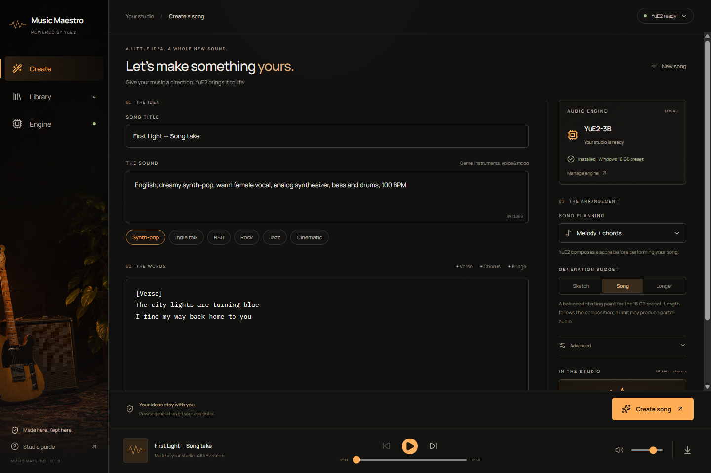

# Music Maestro

A private Windows music studio powered by [YuE2-3B](https://huggingface.co/m-a-p/YuE2-3B). Describe the sound, write your lyrics, compose a song, listen, and export lossless audio. The After Hours interface pairs warm amber controls with a charcoal workspace and an intimate recording-studio backdrop.



## Install and create

Download the [Windows x64 installer](https://github.com/soundtrackgeek/music-maestro/releases/tag/v0.1.0) and run the downloaded `.exe`. Open **Engine → Set up music engine**. Music Maestro provisions its own Python 3.12 environment, installs the pinned CUDA runtime, downloads YuE2-3B and its listening decoder, verifies their checksums, and checks CUDA/BF16 support. No Python installation, terminal, Hugging Face account, API key, or administrator account is needed. The NVIDIA driver must already be installed.

Setup needs internet access, approximately **7.8 GB of model downloads**, approximately **3 GB of runtime downloads**, and around **20 GB free disk space** for the installed environment and download cache. Progress stays visible across pages. Pause setup or close the app; **Resume setup** reuses verified files and resumes partial model downloads. Use **Verify & repair engine** to check or repair a damaged installation. Models are downloaded directly from the authors rather than included in the installer.

Target hardware: **Windows 11 x64, RTX 4060 Ti with 16 GB VRAM, 32 GB system RAM**, and a current NVIDIA driver. Other BF16-capable NVIDIA GPUs with at least 16 GB VRAM can use the same preset. The GPU and system-memory checks happen before setup; CUDA/BF16 are checked before the model download. The engine selects the NVIDIA GPU with the most VRAM when more than one is present. Close memory-heavy applications if resources are scarce. AMD, Intel, CPU-only, macOS and Linux generation are outside this release's support scope.

1. In **Create**, name your song and describe its genre, language, instruments, mood and vocal character. Presets provide starting points.
2. Enter original lyrics, using `[Verse]`, `[Chorus]` and `[Bridge]` section tags. The draft saves automatically on this computer.
3. Choose **Melody + chords**, **Melody only**, or **Direct generation**. Start with **Sketch** when exploring a sound.
4. Choose **Create song**. Watch the real loading, composition, performance, synthesis, decoding and verification stages. You can browse the library while generation runs, or cancel it.
5. Select a finished song in **Library**, play or seek through it, and export **FLAC** or **WAV** using the player’s export button. **Load settings** restores an earlier request for a new take.

Generation is local and works offline after setup. It takes minutes rather than streaming in real time. Sketch/Song/Longer are token budgets (750/3,000/6,000 semantic tokens), not promised durations. Song length follows the generated composition. Audio that hits a score or performance limit is clearly labelled **Partial audio**; it remains playable and exportable. A seed preserves the starting point but does not promise identical output across hardware or runtime versions.

## Windows inference

The [upstream starting point](https://github.com/multimodal-art-projection/YuE/blob/main/docs/generation.md) is Linux with 24 GB NVIDIA VRAM. Music Maestro provides a separate Windows 16 GB adapter: eager PyTorch avoids the Flash Attention call unavailable in the Windows CUDA-graph build; unused autoregressive layers move to system memory during synthesis; acoustic attention uses 128-query tiles; stereo decoding uses 512-frame tiles; and the process reserves GPU headroom. Standard solver settings and BF16 model weights are retained. Generation artifacts record these settings.

Real hardware verification on the target RTX 4060 Ti completed a 30-second Sketch and a complete 51-second Song take through the installed app, including score planning, synthesis, decoding, lossless output and artifact verification. The Song take reached its natural end without truncation, took approximately 154 seconds and peaked at approximately 7.24 GiB of PyTorch allocation. Playback, seeking, volume, native WAV export and engine repair were exercised. These are functional compatibility checks, not a musical-quality evaluation or throughput guarantee. Extended generation remains more demanding and depends on the lyrics, score and other applications using the GPU/RAM. See [verification details](docs/verification.md).

## Local data and recovery

Data lives in `%LOCALAPPDATA%\MusicMaestro\`:

- `models/`: pinned, verified model files and resumable `.partial` downloads.
- `runtime/`: private Python, CUDA dependencies and download cache.
- `studio.sqlite3`: song requests, history and statuses (SQLite WAL).
- `outputs/<run-id>/`: original FLAC, playback WAV, score, semantic tokens, latents, settings and verification records.
- `engine-ready.json` and `runtime-ready.json`: installation records; model files and timestamps are reconciled on startup and weights are hashed again before generation.

Every generation gets a fresh UUID directory. Failures retain the request and report the actual error. Closing the app stops its owned worker; interrupted runs become **Interrupted** on restart and can be loaded for a new take. Setup and generation cannot run simultaneously. Reinstalling the app preserves app data. Back up this folder to keep your songs and requests; uninstalling or deleting the data folder is not a backup. The current library displays the most recent 200 runs.

## Development

Requirements: Node.js 22.12+ or 24+, Rust, Windows C++ Build Tools and WebView2. End users need none of these development tools. Dependencies are pinned by the npm/Cargo locks and the runtime requirements lock.

```powershell
npm ci
npm run desktop
```

`npm run desktop` prepares the verified bundled uv helper and opens the real Tauri app. Vite uses the strict port `1436`, matched by Tauri. `npm run dev` opens a browser preview at `http://127.0.0.1:1436`; native setup/generation remain unavailable in that preview and it never invents completed music.

```powershell
npm run build
npm test
python -m unittest discover -s tests -p "test_*.py"
cargo fmt --manifest-path src-tauri/Cargo.toml --check
cargo clippy --manifest-path src-tauri/Cargo.toml --all-targets -- -D warnings
cargo test --manifest-path src-tauri/Cargo.toml
npm run package
```

The Python download tests use the standard library and an isolated local HTTP server; they do not download a model. The checked-in inference wheel is built from upstream commit `1647252d68b70cbead046ffd3f7caf036dde47ee`. The build provisioner verifies the wheel and uv checksums. `npm run package` produces a Windows GUI executable and a per-user NSIS installer. Distribute the installer; the executable depends on its accompanying `engine/` resources. No code-signing certificate or automatic updater is configured for this first release.

Model files are pinned in `src-tauri/resources/engine-manifest.json`, including immutable Hugging Face revisions, exact byte sizes and SHA-256 hashes. `THIRD_PARTY_NOTICES.md` records source provenance. The selected design and generated photograph prompt are in `docs/design/`.

## Attribution and model license

YuE2 is by Multimodal Art Projection. Its inference code is Apache-2.0; **model weights use CC BY-NC 4.0 (noncommercial)**. The app retains upstream licenses and links to the model terms in Engine. See [the model card](https://huggingface.co/m-a-p/YuE2-3B) and [third-party notices](THIRD_PARTY_NOTICES.md).
